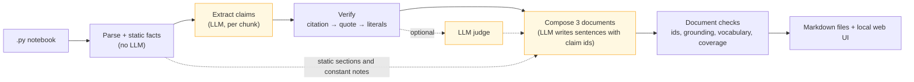
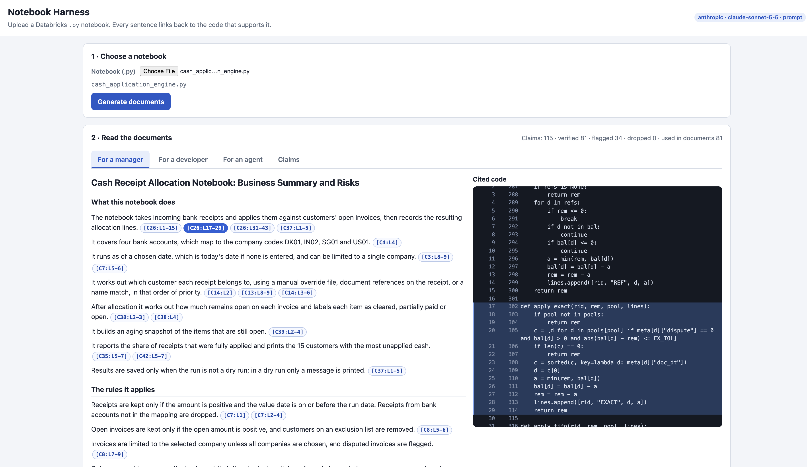

# Databricks Notebook Evaluator

A small local tool for Databricks notebooks. Point it at a `.py` notebook and it writes three
documents about it: one for a manager, one for a developer who is new to the code, and one for an AI
coding agent that will change it. Every factual sentence carries a citation to a cell and line range,
like `[C3:L10-12]`. Click that citation in the web UI and the cited code opens, highlighted.

The central design rule is simple: the model can write the prose, but it cannot invent source
locations. The writing model never sees the notebook and never writes citations. Instead, it selects
IDs from a set of verified claims, and the program attaches the corresponding citations. Claims that
fail verification are dropped or flagged, not silently repaired.

## Quick start

```bash
uv sync --all-extras
cp config.example.toml config.toml   # set [llm].model to a current model name
cp .env.example .env                 # put the key named by api_key_env in it
make run                             # then open http://127.0.0.1:8765
```

You need Python 3.15+ and [uv](https://docs.astral.sh/uv/). Flags: `--port`, `--sample <path>`
(offers a sample notebook you can run in one click), `--judge` (optional LLM judge), `--runs <dir>`
(output directory, `runs` by default). `make test` runs the whole suite offline and needs no API key.

The provider goes in `config.toml`. The key never does. `api_key_env` is the name of the environment
variable the tool should read it from.

| Provider    | Default `base_url`                                 | Default key variable |
| ----------- | -------------------------------------------------- | -------------------- |
| `gemini`    | `https://generativelanguage.googleapis.com/v1beta` | `GEMINI_API_KEY`     |
| `openai`    | `https://api.openai.com/v1`                        | `OPENAI_API_KEY`     |
| `anthropic` | `https://api.anthropic.com/v1`                     | `ANTHROPIC_API_KEY`  |
| `local`     | `http://localhost:11434/v1` (Ollama, LM Studio)    | none                 |

Free-tier Gemini keys are rate limited and will return a 429 now and then. If you just want to see
what the parser makes of a notebook, without calling a model at all:
`uv run python -m harness.parser <notebook.py>`.

## How it works



The amber boxes call the model. Everything else runs in deterministic code.

1. **Parse and analyse.** The parser splits the notebook into numbered cells and lines. It tracks both
   cell-relative locations (such as `C3:L10`) and absolute file line numbers. Python's `ast` module
   and a small SQL scanner identify functions, constants and reassignments, widgets, table reads and
   writes, globals mutated by functions, unused definitions, and calls to names that the file never
   defines.
2. **Extract claims.** The notebook is divided into chunks of at most six cells and 80 lines, with
   neighbouring cells included as read-only context. The model receives a numbered listing rather
   than the raw notebook text. It returns schema-validated claims containing a kind, tag, sentence,
   short quote and citations. Invalid responses are retried through a bounded repair loop. If a
   response is truncated, the chunk is split. If it still fails, the affected region is recorded as
   failed and processing continues.
3. **Verify.** Verification runs in layers, and the first failure determines the outcome. A citation
   must point to an existing cell and line range; otherwise, the claim is dropped. The quoted text
   must appear in the cited lines, or the claim is dropped. Every number, identifier and quoted
   string in the claim must also appear in those lines; if not, the claim is flagged. With
   `--judge`, a second model pass reviews the surviving claims.
4. **Compose.** Three prompts produce the manager, developer and agent documents. Each sentence
   refers to the IDs of the verified claims on which it is based. The agent document's sections on
   mutable state, constants, unused code and invisible dependencies are generated directly from
   static facts rather than written by the model. Each document is checked for valid claim IDs,
   grounding, headings, vocabulary, cell coverage and risk-to-check pairing. At most one repair call
   is allowed. A cross-document check also compares constants against the code, preventing a
   document from mentioning only one of two values.
5. **Publish.** Each run writes `manager.md`, `developer.md`, `agent.md`, `claims.json`,
   `documents.json` and `metrics.json`, along with a copy of the notebook, to a timestamped
   directory under `runs/`. The same results are served through the web UI.

## Design decisions

- **Compose from claim IDs.** The writing model cannot fabricate citations because it never writes
  them. The trade-off is less freedom in how the prose flows.
- **One extraction pass, three composition prompts.** All three documents use the same set of claims,
  which reduces the chance of contradictions between them. Each prompt has its own claim selection,
  vocabulary, document structure and checks.
- **Distinguish claim kinds.** `OBSERVED` describes what the code states. `INFERRED` marks a
  judgement and is always used for risks. `NOT_VISIBLE` covers dependencies on code outside the
  file, such as a notebook invoked through `%run`, and cites the call site. The tool does not
  describe the contents of code it cannot see.
- **Fail closed.** Claims that fail verification are dropped or flagged with a reason. The UI shows
  dropped claims alongside verified ones, so failures are visible rather than silently corrected.
- **Use static analysis where possible.** Facts the program can calculate are supplied to the model
  as hints. For the agent document, some sections are rendered directly from those facts, preventing
  the model from changing their values.
- **Validate structured output locally.** LLM providers handle structured output differently, so the
  tool does not depend on any one provider's function-calling implementation. Prompts specify the
  expected JSON shape, and `json_mode` is requested where supported. With `auto`, it is selected for
  Gemini and OpenAI; Anthropic and local servers use prompt-only instructions. Pydantic validates
  responses locally, and invalid output is retried with the validation error. Provider-native schema
  enforcement is not yet used.
- **Treat notebook content as untrusted input.** Notebook text is enclosed in delimited data blocks
  and is never treated as instructions. The browser renders model-generated text through
  `textContent`, not HTML. Secrets are read from environment variables and scrubbed from logs.
- **Keep the stack simple.** The application uses a standard-library server and vanilla JavaScript,
  with no build step. The browser uploads the notebook, so the server never reads a path chosen by
  the client. The server binds to loopback only.
- **Make the provider configurable.** One config file selects Gemini, OpenAI, Anthropic or a local
  server. A local model keeps notebook code on the machine, which matters when working with finance
  code.
- **Use sample data only as an oracle.** CSV files are used to check what the code does, never as
  model input. Facts about the data are excluded from the generated documents because they cannot be
  cited to a notebook cell and line.
- **Prioritise verification over UI features.** The UI is deliberately plain; features take priority
  over visual polish.

## What is and is not verified

The tool separates checks that code can enforce from judgements that remain probabilistic.

Deterministic checks enforced by code:

- The citation exists and points inside the notebook.
- The quoted snippet appears in the cited lines.
- Every number, identifier and string in the claim appears in the cited lines.
- Document checks cover grounding, cell coverage, audience vocabulary, required agent sections and
  risk-to-check pairing.

Probabilistic checks:

- Which claims the extraction model chooses to make.
- How the composition model phrases those claims.
- The optional judge's assessment, which is another model's opinion rather than proof.

A claim being verified means the required evidence is present. It does not establish that the
sentence is true. For example, a claim that "X is never read" is checked only against its cited
lines. The deterministic checks cannot prove that something never happens elsewhere in the code. This
is why the judge exists and why human review remains on the next-steps list.

## Evals

The test suite covers the pipeline from extraction through verification and composition, as well as
the HTTP app.

- A deterministic `FakeLLM` runs the pipeline and web application offline.
- A collection of invalid model responses—including trailing commas, smart quotes, duplicate keys,
  missing fields, incorrect types, truncated bodies and exhausted repairs—runs through the actual
  repair loop.
- Verifier tests cover each verification layer and every reason a claim can be dropped.
- A prompt-injection fixture checks that instruction-like notebook text stays inside data blocks and
  cannot reach a generated document through a verified claim.
- The reference notebook has manually checked anchors for parsing and static facts.
- Every run writes `metrics.json`, recording schema repairs, dropped or flagged claims, and coverage
  for each document.

## Known limitations

- Only Databricks-exported `.py` notebooks are supported. Other formats are rejected with an error.
- Cell splitting is textual, matching Databricks' separator convention. A separator-looking line
  inside a string literal starts a new cell.
- `%run` targets are not resolved, and notebooks are never executed. Dependencies outside the file
  become `NOT_VISIBLE` claims.
- Chunks never split a cell. A very large cell can exceed the output limit and fail as a region. With
  default settings, the attached notebook (551 lines, 47 cells) runs as eight chunks.
- Static analysis approximates function locals. It does not analyse dynamic access through `eval` or
  `getattr`, globals passed as arguments, classes, SQL CTEs, or `MERGE`/`UPDATE`/`DELETE` statements.
- Rate-limit handling is basic: retries use backoff and `Retry-After`. Free-tier quotas can still be
  exhausted.
- The judge can be wrong in either direction.
- The application supports one job at a time, one user and localhost access only.

## What I'd do next

In priority order:

1. **Reduce the gap between evidence and meaning.** Use a stronger judge model, manually review a
   sample of verified claims to measure precision, and cross-check claims containing "never" against
   the static facts.
2. **Gate changes in CI.** Compare `metrics.json` across prompt and model changes, run cross-provider
   comparisons on several notebooks, and expand the prompt-injection test corpus.
3. **Handle larger notebooks.** Split oversized cells, process chunks in parallel, cache results by
   notebook hash, provider, model and prompts, resolve `%run` targets, and add `.ipynb` support.
4. **Measure runtime and cost.** Track latency, token cost and failure rate by notebook size.
5. **Support multiple users.** Add authentication, per-user storage and a job queue. Define a data
   policy for finance code, starting with the existing local-model option.
6. **Add workflow features.** Allow users to regenerate a single document, compare two notebook
   versions, and feed reviewer corrections back into the evaluation set.

## Screenshot



The local UI requires no build step. Select a `.py` notebook and generate the manager, developer and
agent documents. Click any citation chip to view the exact code behind the sentence, with the
relevant lines highlighted. The Claims tab shows the verified ledger, and the per-run metrics line
reports repairs, dropped claims and document coverage.

## Repository layout

- `harness/parser.py`, `models.py`, `citations.py`: notebook model, line lookups and the citation
  grammar
- `harness/facts.py`: static facts
- `harness/extract.py`, `verify.py`, `compose.py`: the three LLM-facing stages and their checks
- `harness/grounding.py`: number and identifier rules shared by verification and composition
- `harness/llm.py`, `config.py`: provider adapters, structured output, config
- `harness/injection.py`, `metrics.py`: injection scanner and per-run metrics
- `harness/app.py`, `static/`: local server and no-build UI
- `tests/`: suites per stage, plus `fixtures/cash_application_engine.py` and
  `fixtures/prompt_injection.py`
